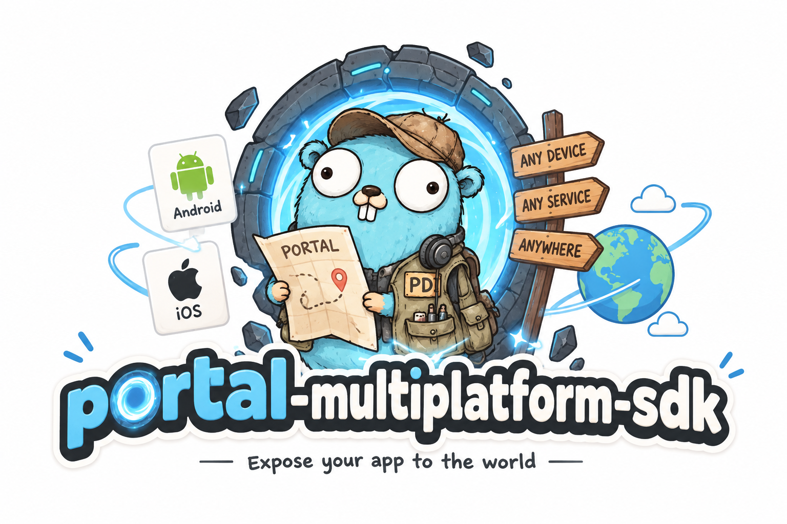
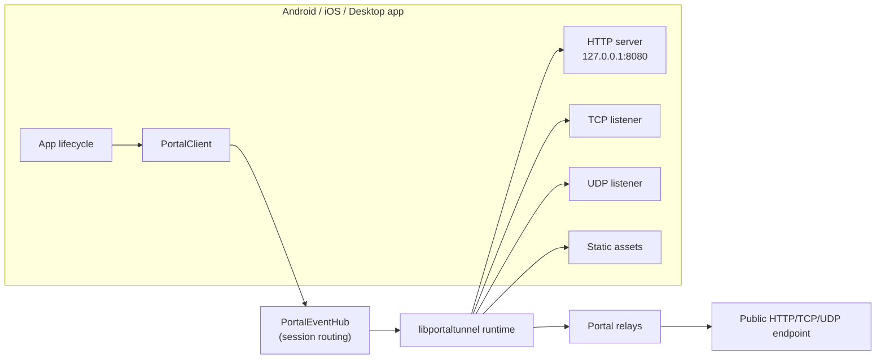

<p align="center">
  
</p>

<h1 align="center">Portal Multiplatform SDK</h1>

<p align="center">
  Expose app-local <b>HTTP</b> servers, <b>TCP/UDP</b> sockets, and static
 assets from Android, iOS, and desktop (JVM) through
  <a href="https://github.com/gosuda/portal-tunnel">Portal</a> relays.
</p>

<p align="center">
  <a href="https://github.com/gosuda/portal-multiplatform-sdk/actions/workflows/gradle.yml"></a>
  
  
  <a href="LICENSE"></a>
</p>

---

## What you can build with it

Portal gives software running inside an Android, iOS, or desktop app a public endpoint —
no public IP or port forwarding required:

- **On-device APIs and webhooks** — expose a Ktor, NanoHTTPD, or other
  loopback HTTP server for callbacks, integrations, and device-local APIs.
- **Mobile game and peer services** — publish TCP or UDP listeners for
  multiplayer sessions, co-op lobbies, and custom protocols.
- **Dev tunnels** — reach an app's local service from remote QA, demos, or
  development tooling.
- **Route-based applications** — send different URL prefixes to local HTTP
  upstreams or bundled assets behind one public endpoint.
- **Static applications** — publish files directly when running an embedded
  HTTP server would add unnecessary weight.
- **Privacy-aware endpoints** — use unlisted discovery and relay-dependent MITM
  self-probing across multiple relays; unlisted does not mean access-controlled.


## Install

The intended Maven coordinates are shown below. `0.1.0` is not published to
Maven Central, and no downloadable GitHub release is available. Use the staged
Maven repository or locally packaged XCFramework below; adding these
coordinates alone will not resolve an unpublished version. Binary publication
is still gated on dependency redistribution review.

```kotlin
dependencies {
    implementation("io.github.gosuda:portal-sdk:0.1.0")
}
```

Android apps that use the optional process/lifecycle helpers also add:

```kotlin
implementation("io.github.gosuda:portal-android-lifecycle:0.1.0")
```

API references: [Swift](docs/SWIFT_API.md). Generate Kotlin reference locally
with `./gradlew :portal-sdk:dokkaGenerate`; release CI attaches
`dokka-html.zip` after successful publication.

The samples consume the intended Maven coordinates rather than `project()`
dependencies. Android JNI libraries are built directly from this repository's
MIT-licensed `native/bridge` with Go and Android NDK r29 during
`portal-native-android` assembly/publication; no external `.so` is downloaded
or republished. To verify an unpublished checkout through an isolated Maven
repository:

```bash
# Requires Go 1.27.3, Python 3.9+, and the host C toolchain.
# Linux additionally needs Zig 0.16.0; Windows needs MinGW; macOS needs Xcode.
./scripts/build-desktop-engine.sh
./gradlew publishDesktopSdkToSampleRepository
./gradlew :samples:desktop:build \
  -Pportal.samples.repository="$PWD/build/sample-maven"

# Requires an installed Android SDK:
./gradlew publishAndroidSdkToSampleRepository
./gradlew :samples:android:assembleDebug \
  -Pportal.samples.repository="$PWD/build/sample-maven"
```

iOS KMP variants embed the matching Go engine archive and propagate required
Security framework linkage. On macOS, build
`:portal-sdk:assemblePortalSDKReleaseXCFramework`, then run
`scripts/package-ios-xcframework.sh`. For SwiftPM, extract
`dist/PortalSDK-swift-package.zip` and add its `PortalSDK` directory using
Xcode's **Add Local Package** action. The ZIP includes the manifest, wrapper
source, and XCFramework; no manual engine or Security linkage is needed.
The repository URL and a standalone release-asset `Package.swift` are not
currently supported remote SwiftPM install paths.

Desktop (JVM) resolves the `portal-sdk-desktop` variant plus the
`portal-native-desktop` runtime JAR transitively — no extra dependency or
native install step. The engine is extracted to a content-addressed cache on
first use; loading the packaged engine does not require a download. Public
tunneling still requires network access and a compatible reachable relay.


## Quick start: two steps to a public HTTP endpoint

Start your own HTTP server on `127.0.0.1:8080` first. The SDK publishes that
server; it does not create it. For a server included in the app, try one of the
[sample workbenches](#explore-the-sdk-in-the-samples).

### 1. Create one long-lived client

Keep the client in your application or another owner that outlives the screen:

```kotlin
// Android
val client = PortalClient(applicationContext)
// Desktop/JVM: use this instead.
// val client = PortalDesktop.client("com.example.myapp")
```

```swift
// iOS
let client = PortalIosClient()
```

### 2. Publish one factory config

Kotlin, from a coroutine:

```kotlin
val tunnel = client.publish(PortalConfig.http("127.0.0.1:8080"))
println(tunnel.publicUrl)
```

Swift:

```swift
let operation = client.publish(
    config: PortalIosConfigFactory.shared.http(targetAddress: "127.0.0.1:8080")
) { session, failure in
    if let failure = failure {
        print("Publish failed: \(failure.code)")
        return
    }
    print(session?.primaryPublicUrl ?? "No HTTP URL")
}
```

That's the normal path: no identity file paths, readiness polling, or
app-written rollback routine. `publish` waits up to 30 seconds for ACTIVE
and stops the session if readiness fails or the call is cancelled. ACTIVE
means **every requested feature** is ready: HTTP/static need a public URL;
TCP and UDP each need their own nonblank endpoint on a ready relay. It is
not an upstream-health check or proof that an application request succeeded.

### When finished: clean up the owner

Keep your server and client alive for the entire tunnel lifetime. Do not
close the client immediately after displaying the URL. Retain the returned
tunnel/session when you need to stop just that publication:

```kotlin
tunnel.stop()   // only this tunnel
client.close()  // at owner teardown: all sessions owned by this client
```

```swift
client.close { failure in
    if let failure = failure { print("Cleanup failed: \(failure.code)") }
}
```

Kotlin failures throw `PortalException`; handle `e.failure.code`,
`.operation`, and `.retryable` in your coroutine. Do not swallow
`CancellationException`. Swift reports the same fields through the
completion's `PortalFailure`; callbacks run on Main. Keep the returned
`PortalOperation` if you need to cancel an in-flight publish. Cancellation
suppresses its Swift completion, but the SDK still owns cleanup.

Cleanup failures remain retryable: a native stop failure keeps the session
in STOPPING and reachable in `client.sessions`. Retry its stop or client
close; keep app-owned listeners alive until cleanup is terminal. You do not
need to implement the SDK's readiness/rollback sequence yourself.

Platform identity storage is automatic. Android uses `filesDir/identity.json`,
iOS uses Application Support, and desktop uses a per-application OS directory.
Display-name changes do not overwrite an existing private identity. Android
background execution needs an explicit foreground-service owner; iOS offers
foreground sessions, not indefinite background execution.

See [Android](samples/android/README.md), [iOS](samples/ios/README.md), and
[desktop](samples/desktop/README.md) for runnable demos and
[the Swift API reference](docs/SWIFT_API.md) for the advanced call surface.

## What it does

This SDK is an app-local tunnel runtime around `libportaltunnel`. `PortalConfig`
describes which app-local service to expose; `PortalClient` owns its tunnel
sessions and reports their authoritative state:

- **HTTP/TLS upstreams and routes** proxy requests to loopback servers running
  in the app process.
- **Raw TCP and UDP tunnels** expose app-owned sockets and custom protocols.
- **Static directories** are a convenience mode, not a required architecture.
- **One lifecycle API** covers relay discovery, structured failures and
  explicit session ownership.
- **`StateFlow` snapshots** are authoritative; bounded events are auxiliary
  notifications.

## Exposure modes

| App-local source | `PortalConfig` shape | Typical use |
|---|---|---|
| HTTP server | `targetAddr = "127.0.0.1:8080"` | APIs, webhooks, dev servers |
| HTTP routes | `httpRoutes = listOf(...)` | Prefix routing, mixed upstreams/static assets |
| TCP listener | `tcp = true, targetAddr = "127.0.0.1:25565"` | Custom protocols, game sessions |
| UDP listener | `udp = true, udpAddr = "127.0.0.1:7777"` | Real-time and datagram protocols |
| Static directory | `staticDir = dir` | Serverless assets and bundled web UIs |

The SDK does **not** create your HTTP/TCP/UDP server, install an application
runtime, or grant background execution. Start and own your local service
before publishing. Static-directory mode serves existing files without an
extra HTTP server. `publish` returning ACTIVE proves tunnel readiness, not
that your upstream is reachable or that an application request succeeded.

TCP and UDP endpoints are in `snapshot.relays[].tcpAddr` / `udpAddr`; they
are not browser URLs. Use a client for your protocol to exercise them.
`hide` only controls discovery listings, not authentication or access control.
The bundled v2.7.1 engine uses relay protocol 10. ECH, x402, priced or
method-constrained routes, and overlay are unsupported; requests fail with
`UNSUPPORTED_CAPABILITY` before native start. Their v1 configuration fields
remain recognizable, never silently treated as applied policy.

## Explore the SDK in the samples

All three sample apps offer five runnable exposure modes. Built-in listeners
live in the sample, not the SDK; custom upstream inputs let you substitute
your own service without changing the tunnel code.

| Mode | Built-in demonstration | How to verify |
|---|---|---|
| Web games / static site | Shared four-game arcade served by the native engine | Open the returned HTTPS URL and play |
| HTTP API / webhooks | Loopback HTTP receiver with bounded request activity | Send GET/POST requests through the public URL |
| HTTP routes | Prefixes dispatch to local demo endpoints | Request each prefix and compare the responses |
| TCP | Loopback echo listener | Send bytes to the relay's TCP endpoint with a TCP client |
| UDP | Loopback datagram echo listener | Send a datagram to the relay's UDP endpoint |

### Play the arcade

1. Select **Web games / static site** in any sample (leave the desktop directory blank).
2. Publish and wait for ACTIVE.
3. Open or share the HTTPS URL. No separate game server or game runtime is installed.

| Game | What you can do |
|---|---|
| Snake | Steer with arrows/WASD or the touch direction pad; eat food, avoid collisions, pause and restart |
| Memory pairs | Match eight shuffled letter pairs with click, tap or keyboard |
| Reaction test | Wait for green; false starts are rejected and successful trials show last/best/median times |
| Water fill | Hold to pour, release to stop, tilt/drag the cup to slosh and spill, then score against a target level |

The flat HTML/CSS/JavaScript bundle has one source:
[`samples/shared/common/site`](samples/shared/common/site). Android packages it
as assets, iOS as a resource folder, and desktop as Compose application resources.
These are client-side games, not multiplayer or a server-side leaderboard.
Scores stay in the browser tab. Switching games or hiding the page pauses
timers and releases held input.


Use the workbench to publish/stop, inspect authoritative state and relay
endpoints, edit live metadata, add/remove relays, and inspect diagnostics.
Settings apply to the next publish; live operations act on the owned session.
Sample names do not replace an existing private identity: the platform
identity persists across launches.

Android background use requires the sample's explicit foreground-service
option. iOS remains foreground-only; desktop keeps running only for the
lifetime of its process. See the platform READMEs for run commands and local
upstream prerequisites.

## Architecture



| Layer | Where | Contract |
|---|---|---|
| `PortalClient` / `PortalTunnel` | `commonMain` | configuration, snapshots, failures, ownership |
| `PortalEventHub` | `commonMain` | one native callback → correct session owner |
| `PortalNativeEngine` | platform adapters | raw string/JSON ABI seam |
| JNI bridge | `portal-native-android` | `org.gosuda.portal.android.internal.NativeBridge` |
| cinterop | `nativeMain` | `portaltunnel.def` → `native/include/portaltunnel.h` |
| Swift facade | `iosMain` | `PortalIosClient` / `PortalIosSession` callbacks |

## Platform matrix

| Target | Status | Native engine |
|---|---|---|
| `android` (arm64-v8a, x86_64) | Supported local builds | JNI `libportaltunnel.so` built from `native/bridge`, 16 KB-page aligned |
| `iosArm64` / `iosSimulatorArm64` / `iosX64` | Supported local builds | matching `libportaltunnel.a` embedded in each packaged KMP klib/XCFramework slice |
| `desktop` (JVM 17+, linux-x64 / windows-x64 / macos-universal) | Supported packaging targets | `libportaltunnel` shared library packaged in `portal-native-desktop`, loaded via JNA |
| `linuxX64` | 🧪 experimental | C stub for tests; link the real `.so` for production |


## Usage

### Configuration

`PortalConfig` selects the app-local service and optional relay features.
Intent factories cover the common exposure modes; the raw constructor and
`PortalConfig.Builder` remain for advanced combinations:

```kotlin
// Proxy a local HTTP server
PortalConfig.http("127.0.0.1:8080", name = "api")

// Route prefixes to one or more local HTTP services
PortalConfig.routes(
    listOf(
        PortalHTTPRoute(prefix = "/api", upstream = "http://127.0.0.1:8080"),
        PortalHTTPRoute(prefix = "/admin", upstream = "http://127.0.0.1:9090")
    ),
    name = "routes"
)

// Raw TCP / UDP listeners
PortalConfig.tcp("127.0.0.1:25565", name = "tcp-service")
PortalConfig.udp("127.0.0.1:7777", name = "game")

// Static assets without an embedded HTTP server
PortalConfig.staticSite(dir, index = "index.html", name = "site")

// Advanced: raw constructor for combinations the factories don't cover
PortalConfig(name = "private", discovery = false,
             relays = listOf("https://portal.example.com"))

```
Routing uses the **longest matching path prefix**, not the order entered.
Use `/` as a catch-all fallback. Each route needs exactly one of `upstream`
or `staticRoot`.


Key rules: `identity_json` XOR `identity_path`; `discovery=false` needs ≥1
relay; relays are `https`-only (`http` allowed for loopback); targets are
loopback-only unless `PortalClient(allowRemoteTargets = true)`.

### Lifecycle & ownership

- One `PortalClient` per app (or long-lived component). It owns every
  `PortalTunnel` it opens.
- `client.publish(config)` returns only after the tunnel reports ACTIVE and
  stops the session if readiness fails — the easy path for "give me a URL".
- `client.open(config)` returns once the native runtime accepted the start;
  readiness is observed via `state`/`awaitReady`/`awaitActive`.
- `client.close()` stops exactly the sessions it owns — never another
  client's. Safe to call twice; concurrent calls serialize.
- `tunnel.stop()` is idempotent and retryable: a native failure leaves the
  session in `STOPPING`, not `STOPPED`.
- Cancelling `open` or `publish` rolls the native handle back — no orphaned
  sessions.
- ACTIVE requires all requested capabilities. A ready HTTP lease cannot
  substitute for a TCP or UDP endpoint on a ready relay.

For advanced accepted-before-ready UI, use `open` and observe state in a
separate coroutine; `open` does not imply readiness:

```kotlin
val tunnel = client.open(PortalConfig.http("127.0.0.1:8080"))
// Render tunnel.state from a separate collector.
val ready = tunnel.awaitReady(Capability.HTTP_TLS)
// Or wait for every requested feature: tunnel.awaitActive(15_000)
```


### Observing state

```kotlin
// Authoritative snapshot — render this in UI.
tunnel.state.collect { snap ->
    snap.phase               // IDLE → STARTING → CONNECTING → ACTIVE → …
    snap.primaryPublicUrl    // first public URL, if any
    snap.relays              // per-relay state/failure/error
    snap.hasSecurityWarning  // sticky MITM flag
    snap.isActive / isTerminal
}

// Auxiliary events (bounded, not replayed).
tunnel.events.collect { event -> /* Started / StatusChanged / … */ }

// Aggregate stream across all sessions this client owns.
client.events.collect { event -> … }

// Live session list (open order).
client.sessions.collect { list -> … }
```

### Live updates without restart

```kotlin
tunnel.updateMetadata(PortalMetadata(description = "new", tags = listOf("x")))
tunnel.addRelay("https://portal.example.com")
tunnel.removeRelay("https://portal.example.com")
tunnel.refresh()   // pull authoritative native status now
```

### Identity

```kotlin
val identity = PortalIdentity.generate("my-app")   // native-generated keys
val restored = PortalIdentity.parse(savedJson)      // validate + redacted toString
config = PortalConfig(identityJson = identity.document, ...)
// or let the engine persist one:
PortalConfig(identityPath = File(filesDir, "identity.json").absolutePath, ...)
```

`PortalIdentity.document` contains key material — redacted from `toString`;
store it in Keystore-wrapped storage / Keychain, never log it.

When a config sets neither `identityJson` nor `identityPath`, the SDK supplies
a platform-owned default: `filesDir/identity.json` on Android (via
`PortalClient(context)`), `Application Support/Portal/identity.json` on iOS,
and a per-OS application directory on desktop (via `PortalDesktop.client`).

### Kotlin DSL + Android Context

```kotlin
val config = portalConfig {
    setName("device-api")
    setTargetAddress("127.0.0.1:8080")
    setDiscovery(true)
}

// Android: defaults identity_path to filesDir/identity.json
val client = PortalClient(context)
```

### Android: surviving background & rotation

`portal-android-lifecycle` keeps a tunnel alive past the screen:

```kotlin
// Application.onCreate
PortalClientHolder.init(this)

// Foreground service for tunnels that must run while backgrounded
class TunnelService : PortalTunnelService() {
    override fun buildNotification(): Notification = …
}
// manifest: <service android:name=".TunnelService"
//   android:foregroundServiceType="dataSync"/>
```

### Diagnostics

```kotlin
val d = client.diagnostics()
// d.sdkVersion, d.engineVersion, d.abiVersion, d.activeSessions,
// d.droppedOrphanEvents, d.droppedAggregateEvents, d.sessions[]
// per session: phase, revision, droppedEvents, activeRelay, lastFailure
```

Diagnostics never contain identity documents, keys, tokens, or request
bodies — safe to attach to a bug report.

### Managed lifetime

One owner per tunnel lifetime; each pattern stops only sessions that owner
created:

```kotlin
// JVM / desktop / common: scope-bound use{} — close() runs even on failure.
PortalDesktop.client("com.example.myapp").use { client ->
    val tunnel = client.publish(PortalConfig.http("127.0.0.1:8080"))
    println(tunnel.publicUrl)
}   // client.close() stops only its own sessions

// Android: process-owned client + ready-on-return callback.
PortalClientHolder.init(this)   // Application.onCreate
PortalClientHolder.publish(PortalConfig.http("127.0.0.1:8080")) { result ->
    result.onSuccess { println(it.publicUrl) }
}
// Backgrounded tunnels: subclass PortalTunnelService (foreground service).
```

```swift
// iOS: the client owns sessions; close tears down only its own.
let client = PortalIosClient()
let op = client.publish(config: config) { session, failure in
    if let failure = failure { print(failure.code) }
    else { print(session?.primaryPublicUrl ?? "No HTTP URL") }
}
op.cancel()          // cancels the in-flight publish; completion never fires
client.close { _ in } // stops every session this client opened
```

### Structured publish failures

`publish` failures are typed — no message parsing needed:

```kotlin
try {
    client.publish(config)
} catch (e: PortalException) {
    val f = e.failure
    f.code              // STOP_TIMEOUT, TUNNEL_CLOSED, INVALID_CONFIG, …
    f.operation         // "publish" or "publish_cleanup"
    f.retryable         // safe to retry the operation
    f.terminalPhase     // FAILED/STOPPED when the session ended first
    f.readinessFailure  // the readiness error when cleanup itself failed
}
```

The same fields reach Swift through `PortalFailure` — `failure.operation`,
`failure.retryable`, `failure.terminalPhase`, `failure.readinessFailure`.


## Recipes

### Expose a TCP listener (game server, custom protocol)

```kotlin
val tunnel = client.publish(
    PortalConfig.tcp("127.0.0.1:25565", name = "custom-protocol")
)
// The relay hands out a TCP endpoint; read it from the relay status:
tunnel.state.value.relays.firstOrNull { it.isReady && !it.tcpAddr.isNullOrBlank() }?.tcpAddr
```

### Expose a UDP listener

```kotlin
val tunnel = client.publish(PortalConfig.udp("127.0.0.1:7777", name = "voice"))
tunnel.state.value.relays.firstOrNull { it.isReady && !it.udpAddr.isNullOrBlank() }?.udpAddr
```

### Route URL prefixes to different local services

```kotlin
val tunnel = client.publish(
    PortalConfig.routes(
        listOf(
            PortalHTTPRoute(prefix = "/api", upstream = "http://127.0.0.1:8080"),
            PortalHTTPRoute(prefix = "/", staticRoot = siteDir.absolutePath)
        ),
        name = "app"
    )
)
```
The longest matching prefix wins regardless of list order: `/api` selects the
upstream and `/` is the static fallback. These are path prefixes, not
method constraints; method-constrained routes are unsupported.


### Publish a directory without an HTTP server

```kotlin
val tunnel = client.publish(
    PortalConfig.staticSite(dir.absolutePath, index = "index.html", name = "site")
)
```

### Keep an Android tunnel alive in the background

Android kills background processes; a tunnel that must serve while the app
is backgrounded needs a foreground service the app explicitly owns:

```kotlin
class TunnelService : PortalTunnelService() {
    override fun buildNotification(): Notification = …
}
// manifest: <service android:name=".TunnelService"
//   android:foregroundServiceType="dataSync"/>
// then: service.startTunnel(config) — tunnels outlive any Activity.
```

### Persist and reuse an identity

No code needed on the easy path: `PortalClient(context)` (Android),
`PortalIosClient()` (iOS), and `PortalDesktop.client(appId)` (desktop) each
default `identity_path` to persistent platform storage, so the public name
survives relaunch. To manage keys yourself:

```kotlin
val identity = PortalIdentity.generate("my-app")
// store identity.document in Keystore-wrapped storage / Keychain — never log it
val config = PortalConfig.http("127.0.0.1:8080").copy(identityJson = identity.document)
```

### Handle failures by structured fields

```kotlin
try {
    client.publish(config)
} catch (e: PortalException) {
    when (e.failure.code) {
        PortalFailure.Codes.STOP_TIMEOUT -> /* relay slow; retry */
        PortalFailure.Codes.TUNNEL_CLOSED -> /* inspect e.failure.terminalPhase */
        PortalFailure.Codes.INVALID_CONFIG -> /* fix the config */
        else -> if (e.failure.retryable) /* retry */ else /* report */
    }
}
```

See the [troubleshooting decision tree](docs/TROUBLESHOOTING.md#decision-tree--runtime-symptoms--structured-fields--fix)
for symptom → field → fix mappings.

## Compatibility

| SDK | Kotlin | Android | iOS | Desktop JVM | Native architectures |
|---|---|---|---|---|---|
| 0.1.0 | 2.4.x | minSdk 26, NDK r29 (build-time only) | iOS 16+ | 17+ | android: arm64-v8a, x86_64 · ios: arm64, sim arm64/x86_64 · desktop: linux-x64, windows-x64, macos-universal |

The bundled `libportaltunnel` engine is built from `native/bridge` over
portal-tunnel v2.7.1 (C ABI v1, relay protocol 10). iOS Kotlin/Native consumers get the engine
archive embedded in each published klib; JVM consumers get it inside
`portal-native-desktop`. Experimental `linuxX64` consumers still link the
real shared library explicitly.


## Design rules (the short version)

- `identity_json` XOR `identity_path`; `discovery=false` requires ≥1 relay.
- Relay URLs are `https` only — bare hosts default to `https`, `http` is
  accepted only for loopback (the engine upgrades it). Mirrors
  `utils.NormalizeRelayURL` in portal-tunnel.
- `target_addr`/`udp_addr` are loopback-only unless `allowRemoteTargets`.
- `hide=true` hides the listing; it is not access control. MITM suspicion is a
  sticky `hasSecurityWarning`, not proof of compromise.
- `overlay` is not in the v1 capability set → `UNSUPPORTED_CAPABILITY`.

Full contract: [docs/DESIGN_RULES.md](docs/DESIGN_RULES.md) ·
Troubleshooting: [docs/TROUBLESHOOTING.md](docs/TROUBLESHOOTING.md) ·
Known gaps & release gates: [TASKS.md](TASKS.md),
[native/source-lock.json](native/source-lock.json).

## Updating the native engine

Every native engine is built from `native/bridge`; no prebuilt JNI artifact
is downloaded. Update the pinned Portal Tunnel dependency in
`native/bridge/go.mod` with Go tooling, review `go.sum` and
`native/source-lock.json`, then rebuild and verify the supported native
matrix. The obsolete prebuilt synchronization script was removed.

Each build writes a `.provenance.json` sidecar with source/toolchain hashes.
Release CI collects these into `native-source-lock.json` and rejects mixed
or modified artifacts. Only matching `release-v<SDK version>` tags on
`release(scope):` commits may publish; manual dispatch defaults to
verification-only.

Binary publication remains blocked on the bundled-dependency redistribution
review recorded in `native/source-lock.json`. The v2.7.1 SDK dependency graph
no longer links the previous `go-ethereum`/LGPL dependency, but that does not
replace a complete notices/source/redistribution review. Local builds remain
available.

## Repository layout

```
portal-sdk/               KMP library (commonMain / androidMain / nativeMain / iosMain / desktopMain)
portal-native-android/    JNI bridge + source-built libportaltunnel.so
portal-native-desktop/    Verified desktop libportaltunnel runtime JAR (linux/windows/macos)
portal-android-lifecycle/ Process-scoped client + foreground-service base
native/                   portaltunnel.h, C test stub, source provenance
samples/android/          Compose SDK workbench + explicit foreground owner
samples/ios/              SwiftUI SDK workbench + XCFramework instructions
samples/desktop/          Compose Desktop SDK workbench + local/relay smoke
docs/                     DESIGN_RULES, TROUBLESHOOTING, WORK_CHECKPOINT
.agents/skills/           agent skill: API reference, examples, troubleshooting
```

## Contributing

See [CONTRIBUTING.md](CONTRIBUTING.md). In short: `./gradlew build` must stay
green, commits follow `type(scope): subject`, and CI runs on `release-*` tags
or manual dispatch.

## License

Apache-2.0 — see [LICENSE](LICENSE).
